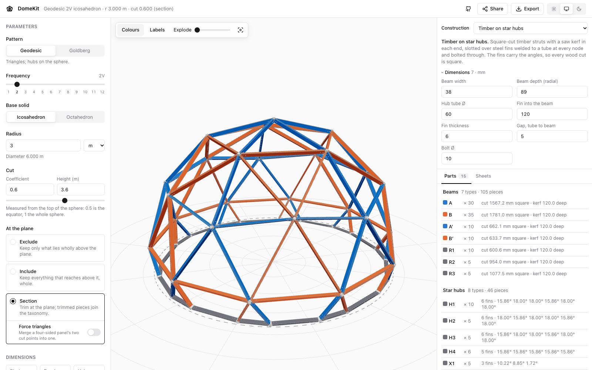
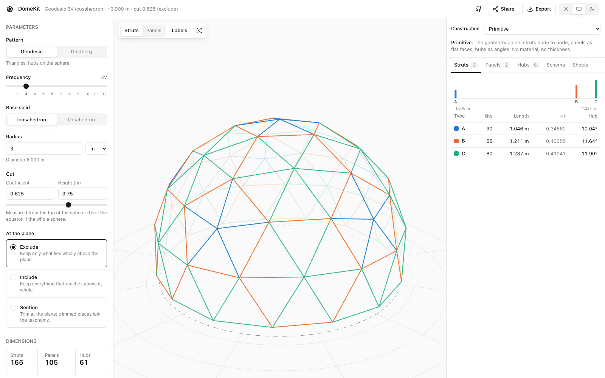
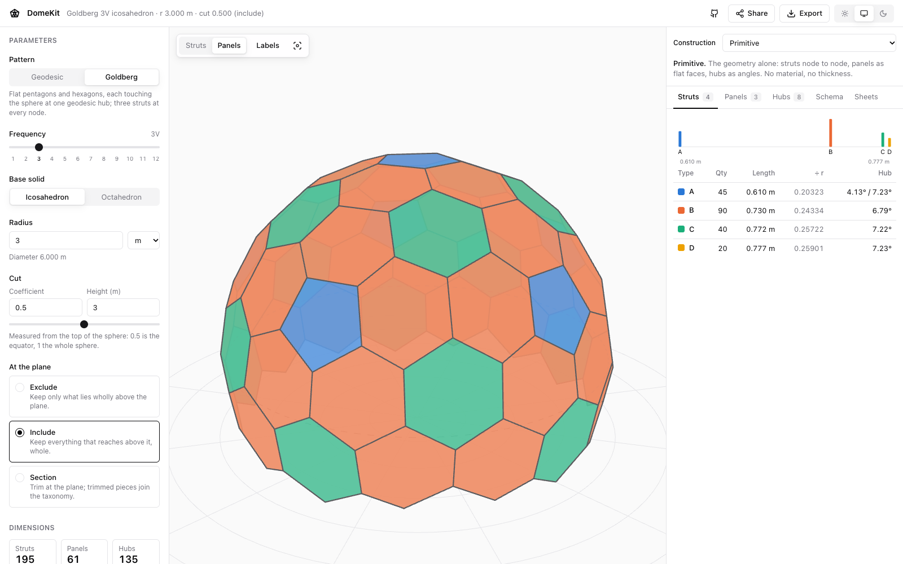
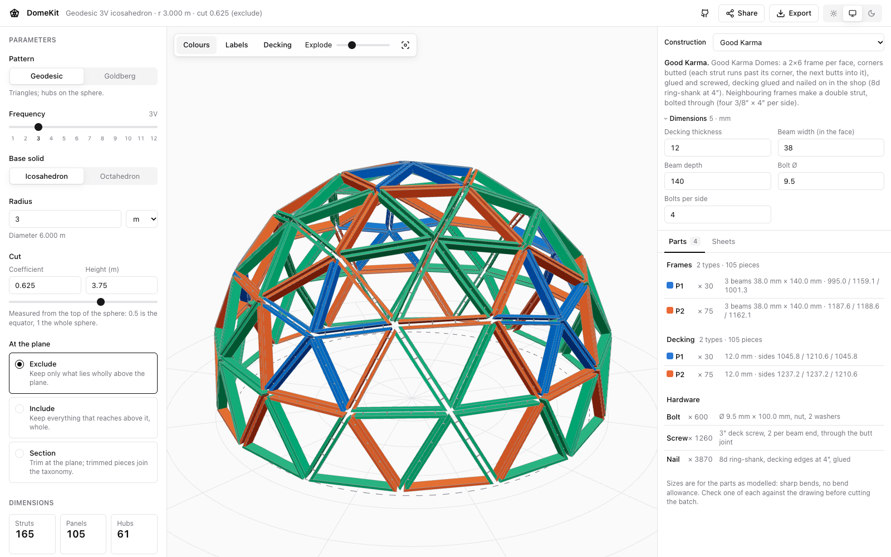
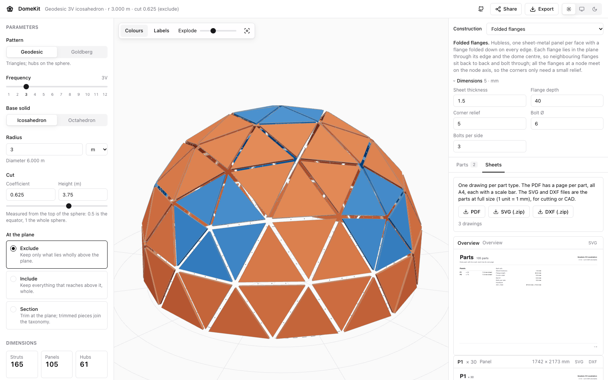
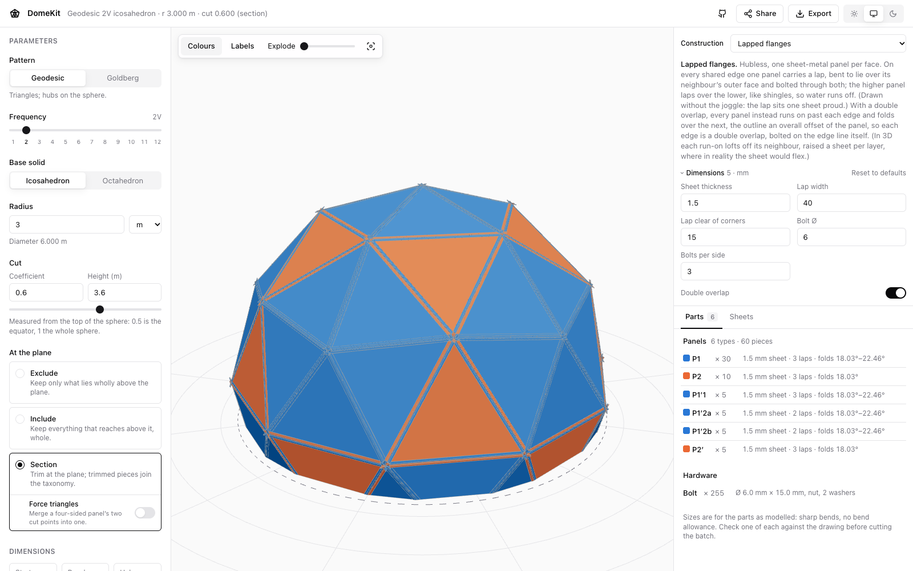
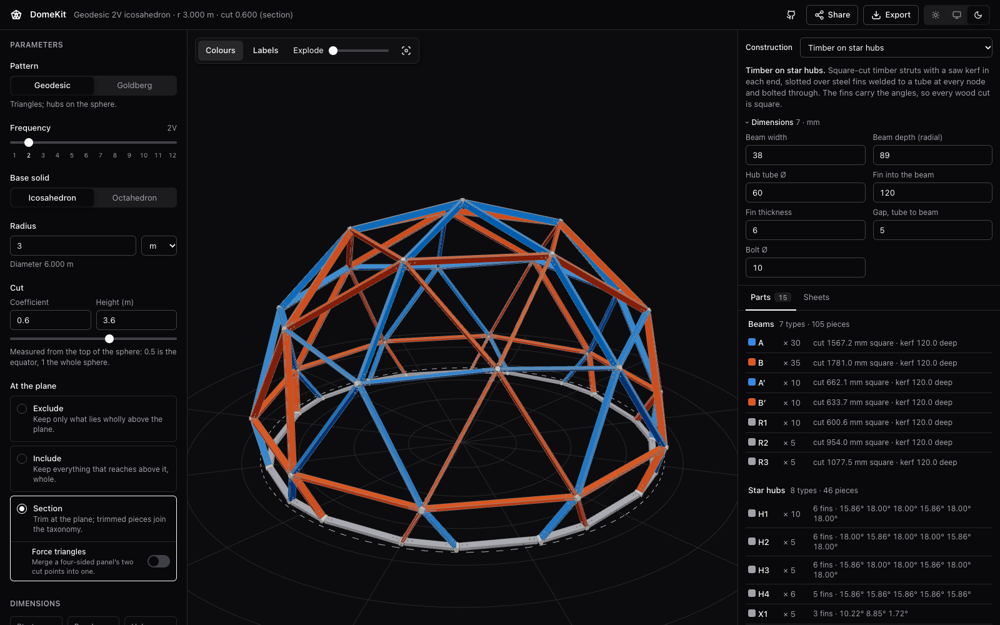
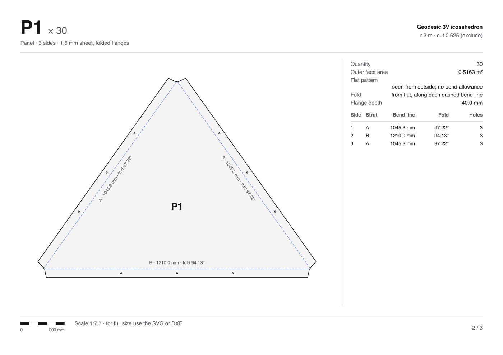
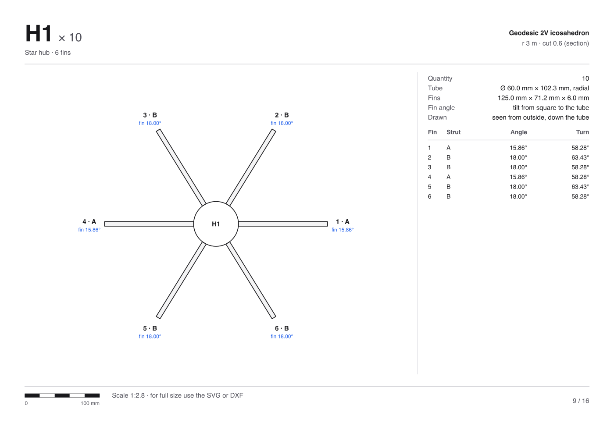

# DomeKit

**Design a geodesic dome, then get everything you need to build it.**
Pick a pattern, a frequency, a radius and where to cut the sphere; DomeKit
classifies every strut, panel and hub, then turns the dome into real parts for
one of nine construction techniques, with drawings, cut lists and a 3D model.

**Open it: https://domekit.pages.dev** (runs entirely in the browser, nothing
to install; also at https://pileoni.github.io/domekit/).



## Highlights

- **Geodesic or Goldberg**, icosahedron or octahedron, 1V to 12V, cut at any
  height: keep whole pieces, or trim them flat at the plane (optionally keeping
  every trimmed panel a triangle).
- **Taxonomy**: strut, panel and hub types, with chord factors, angles at
  every end, and mirror pairs.
- **Nine ways to build it**: sheet panels, folded or lapped sheet metal,
  single and double mitre timber, Good Karma frames, flattened pipe, plate hubs,
  and timber on star hubs. Each with its own dimensions, parts list, hardware and
  warnings when the numbers don't work.
- **Drawings for every part**: printable PDF with a scale bar, plus full-size
  SVG and DXF for cutting; STEP for CAD; OBJ, CSV cut and hub lists, JSON.
- **Remembers everything** between visits, and **Share** makes one link that
  opens your exact dome, construction and dimensions anywhere.

## Gallery

| | |
|---|---|
|  |  |
| **Primitive**: 3V geodesic, struts coloured by type | **Goldberg**: the dual, flat pentagons and hexagons |
|  |  |
| **Good Karma**: a 2×6 frame per face, exploded | **Folded flanges**: sheet-metal panels and their drawings |
|  |  |
| **Lapped flanges**: double overlap, bolted on the fold | **Dark mode** |

Every part type gets a drawing sheet:

| | |
|---|---|
|  |  |

## Run it locally

```sh
npm install
npm run dev        # http://localhost:5173
npm test           # geometry, construction and share-link tests (vitest)
npm run build      # type-check + production bundle in dist/
```

Every push to `main` deploys twice: Cloudflare Pages builds it to
https://domekit.pages.dev, and GitHub Actions tests, builds and deploys it to
GitHub Pages (`.github/workflows/pages.yml`). The build uses relative paths, so `dist/` can
be served from any folder or host.

## What it generates

- **Two patterns.** *Geodesic*: the subdivided sphere, triangles, hubs on the
  sphere. *Goldberg*: its dual (the polar reciprocal about the sphere), flat
  pentagons and hexagons, each lying in the sphere's tangent plane at one
  geodesic hub, three struts at every node. Neighbouring panels share corners
  exactly, so every panel can be cut from flat stock. Both run through the same
  cut, taxonomy and export pipeline.

- **Class I, Method 1** subdivision (each base triangle gridded flat, then
  projected to the sphere) of an **icosahedron** or **octahedron**, 1V–12V.
- The base solid stands on a vertex: a 5-way hub (icosahedron) or 4-way hub
  (octahedron) at the zenith.
- **The cut** is a plane, placed by a **coefficient** (distance from the top
  of the sphere over its diameter: 0.5 is the equator, 1 the whole sphere) or,
  by a **height** in your unit; the two fields are linked. It is continuous:
  the plane need not pass through hubs.
- **What happens at the plane** (`mode`):
  - `exclude`: keep only struts and panels wholly above it.
  - `include`: keep everything that reaches above it, whole (the base steps
    below the plane).
  - `section`: trim at the plane. Crossing struts become **cut pieces**,
    crossing panels are clipped (to triangles or quads), and the plane gets a
    **base ring** of struts between the new **cut points**. The base is flat
    and the height is exactly the cut.
    With `triangulate` ("Force triangles"), every clipped panel that would
    have four or more corners has its cut points merged into one, their mean,
    which is still on the plane: geodesic panels stay triangles and the base
    stays flat. The struts to the merged point no longer run along their
    parent strut.
- Hubs within 1e-6 r of the plane count as on it, so rounding never makes
  sliver pieces. `Dome.flatCuts` lists the coefficients where a whole ring of
  hubs lies on the plane (flat base, nothing trimmed).

## Taxonomy

| Family | Grouped by | Named |
|---|---|---|
| Struts | length (chord factor) and the angles at its two ends | `A`, `B`, `C`… shortest first |
| Cut struts | parent type, trimmed length, angle to the plane | `B′`, or `B′1`, `B′2`… |
| Base ring | length | `R1`, `R2`… |
| Panels | sides and corners in order around the panel (rotations are one type) | `P1`, `P2`… with their signature (`AAB`); mirror pairs flagged |
| Cut panels | parent panel, side lengths | `P2′`, or `P2′1`, `P2′2`… |
| Hubs | the arms in order around the hub: strut type, dip, turn (rotations of the same ring are one type) | `H1`, `H2`…; mirror pairs flagged |
| Cut points | the struts meeting there | `X1`, `X2`… |

Strut and panel names come from the **whole sphere**, so a strut keeps its
letter and colour whatever height the dome is cut at. Chord factors match the
published tables (e.g. 3V: 0.34862 / 0.40355 / 0.41241); see
`src/geodesic/generate.test.ts`.

Each hub type lists its **arms** counter-clockwise seen from outside: the strut
type, its **dip** below the tangent plane, the **turn** around the hub axis to the next arm, and the true 3D angle
**between** neighbouring struts. Every node's axis is the sphere radius, cut
points included: the dome is never squared off to the ground plane. Two hubs with the same struts in a different
order, or at different angles, are different connectors; a type that is another's
mirror image (same arms, opposite hand) is marked as its pair. The hub list
export has one row per arm.

Cut pieces are pieces like any other: they are counted, measured and exported
in the cut list. They wear their parent's colour (hatched in the tables, dashed
in the model); ring struts are grey.

Colour: every whole type gets its own hue, as far as possible from all the
others (the first eight are a validated colour-blind-safe order; the rest are
picked furthest-first in OKLab). With many types some hues come close, so the
label always names the type.

## Drawings

The **Sheets** tab (and Export → Drawings) gives one drawing per part type,
in three forms:

- **PDF, printable**: a page per part, all the same size (A4, or US Letter
  for imperial domes): header with label and quantity, the part scaled to
  fit with its annotations, a data table, and a footer with a true scale bar
  and the scale ratio. First page: the parts list and the face schema.
- **SVG, full size** (zip): each part at 1:1, 1 unit = 1 mm (1 inch for
  imperial domes), with its notes and a 100 mm (4 in) check bar. Layers
  `outline` (red, cut), `marks` (blue), `text`.
- **DXF, full size** (zip): the same as DXF R12, layers `OUTLINE`, `MARKS`,
  `TEXT`, units in the header.

What each part shows:
- **Panels**: true shape seen from outside; per side its strut, length and
  bevel (half the angle to the neighbouring panel); each corner's angle.
- **Struts**: length node to node, square ends; the angle at each end (and,
  for cut pieces, where they meet the base plane) as data only: how an end
  is finished belongs to the construction, not the primitive.
- **Hubs**: a template of the arms at their true turns, with dips (arm length
  nominal: the hub's size comes with the construction technique).

No nesting: lay parts out in your own tool. A part small enough to fit is
printed at 1:1 on its page.

## Construction

The right column starts with a dropdown of techniques: **Primitive** (the
geometry alone), or one of nine ways to build it, each with its own material
dimensions (millimetres, or inches for imperial domes; kept per technique, so switching back finds them as you left them):

| Technique | Parts | Dimensions |
|---|---|---|
| **Sheet panels** | hubless sheet panels, edges cut toward the dome centre so neighbours meet flush; outer and inner face, bevel per side | sheet thickness |
| **Folded flanges** | hubless sheet-metal panels with a flange folded down on every edge, in the plane through the edge and the centre, so neighbouring flanges sit back to back and bolt through; flat pattern with bend lines, fold angles (past 90°) and holes lined up across each edge | sheet thickness, flange depth, corner relief, bolt Ø, bolts per side |
| **Lapped flanges** | hubless sheet-metal panels; on each shared edge one panel carries a lap bent onto its neighbour's outer face (higher over lower, like shingles; ties turn with the dome's symmetry), bolted through both; drawn without the joggle. Switch **Double overlap**: every panel runs on past each shared edge and folds onto the next, bolted on the fold line; the outline is an overall offset of the panel (no corner cuts). In 3D each run-on lofts off its neighbour (a short ramp, then raised a sheet per layer) so stacked run-ons don't cut through each other | sheet thickness, lap width, lap clearance from corners, bolt Ø, bolts per side, double-overlap switch |
| **Flattened pipe** | tubes with flattened, drilled, bent ends, stacked on one bolt per node: cut length, hole to hole, bend at each end | tube Ø and wall, flat length, hole to end, bolt Ø |
| **Single mitre** | one timber strut per edge, shared by its two faces; each end cut to a point (two mitres meeting on the node axis), so the struts meet tip to tip; ridged top under the decking | decking thickness, strut width and depth |
| **Double mitre** | a frame per face, so every edge is two struts side by side, bevelled to sit face to face and bolted through; frame corners mitred (compound) | decking thickness, beam width and depth, bolt Ø, bolts per side |
| **Good Karma** | as double, but frame corners butted in a pinwheel: each beam runs through its start corner, the next butts into it; 2×6, glued and screwed, decking glued and nailed (8d ring-shank at 4″), four 3/8″ bolts per side | same, 2×6 by default |
| **Plate hubs** | a flat plate per node, tangent to the sphere, holes on a circle; tubes with flattened, bent ends bolt under it | plate thickness, hole distance from centre, plate edge, and the tube's |
| **Timber on star hubs** | square-cut timber struts standing radial, a saw kerf in each end, slotted over steel fins welded to a tube at each node and bolted through; the fins carry the angles | beam width and depth, tube Ø, fin length and thickness, gap, bolt Ø |

Each technique gives:
- the parts list (Parts tab) and hardware, with warnings when the numbers
  do not work (a flat too short to clear its hole, holes crowding on a plate,
  a sheet too thick for its panels);
- the model as shaded solids in type colours (frame beams take their
  strut's colour, so double struts and corner joints show), or plain
  off-white with the **Colours** button off; a **Decking** toggle shows the decking over
  the frames (off by default; the exports always have it); hover and select
  as for the primitive, with
  an **Explode** slider that pulls the parts apart (a strut with its ends, a
  hub with its fins, sheathing off its frame) to show how they fit;
- drawings of every part type (PDF, SVG, DXF): tubes laid flat with an
  enlarged end detail, plates seen from outside, panels with both faces;
- **STEP** (Export → Parts, 3D): every part as a closed solid, placed, in
  millimetres; opens as separate bodies in FreeCAD, Fusion, SolidWorks,
  Onshape, Rhino. Round parts are 16-sided prisms.

Sizes are for the parts as modelled: sharp bends, no bend allowance, and
for pipe the bend of a tab mid-stack (where a tab sits in the stack moves
its bend by a fraction of a degree). Make one of each before the batch.

## Interface

Parameters on the left, the model in the middle, the taxonomy on the right
(Struts, Panels, Hubs, Schema). The model is drawn as flat vector lines; panels
are a faint fill that pushes back the struts behind them. Hover any type, in a
table or in the model, to light it everywhere; click to select it (Esc or a
click on empty space clears). Picking in the model opens the matching tab.
The Labels toggle writes each strut's (or panel's) type on the model.
Highlights ease in and out over about 200 ms; what is not in focus recedes
less in dark mode, where faded lines would otherwise vanish.

The header has **Share** (copies a link to this exact dome, see below),
**Export** (every download), the theme (light, system, dark) and a link to this
repository.

## Layout

```
src/
  geodesic/         the core: pure TypeScript, no DOM, no three.js
    polyhedra.ts    base solids, vertex at the zenith
    generate.ts     subdivide → cut → classify → measure
    types.ts        the Dome shape the UI consumes
    export.ts       OBJ, CSV cut list, JSON
    sheets.ts       drawings: shapes → SVG, DXF, printable pages
    build.ts        construction techniques → parts, drawings, solids
    solid.ts        closed polyhedral solids (prism, cylinder, slab)
    step.ts         STEP AP214 writer for those solids
  components/       React UI: ui.tsx (controls), Viewport (react-three-fiber),
                    Taxonomy (tables, spectrum, schema), Construction
                    (technique, dimensions, parts), Sheets, Controls, Stats,
                    Export, Share
  lib/              palette, theme, units; state.ts (settings and their
                    cleaning), store.ts (Jotai atoms in localStorage),
                    share.ts (versioned share links)
```

## State and sharing

Every option (the dome, the construction and each technique's dimensions,
the view, the open tab) lives in Jotai atoms kept in `localStorage`: leave and
come back, and it is as you left it. The URL stays clean.

**Share** copies a link, `…/#share=<payload>`: one JSON document, deflated and
base64url-encoded, holding the dome, the construction with every dimension
(defaults included, so the link stands alone) and the view:

```json
{ "app": "geodesic", "v": 1,
  "dome": { "pattern": "geodesic", "frequency": 2, "solid": "icosahedron", "radius": 3,
            "unit": "m", "cut": 0.6, "mode": "section", "triangulate": false },
  "build": { "technique": "lapped", "dims": { "thickness": 1.5, "lap": 40, "…": "…" } },
  "view": { "colorBy": "struts", "labels": false, "explode": 0, "look": "type", "decking": false } }
```

Opening a link applies it (with an Undo), then removes it from the address
bar. Every value is checked and clamped on the way in. `v` is the format
version: a link newer than the app, or older than `MIN_SHARE_VERSION`, is
refused with a message rather than half-applied. To change the format
incompatibly, bump `SHARE_VERSION` and add a step to `MIGRATIONS` in
`src/lib/share.ts`. The old `#p=…&v=…` links still open, as version 0.

The UI only calls `generateDome(params): Dome`. To move the geometry to Rust,
build a WASM module that returns the same `Dome` shape (flat arrays for
`vertices`, `struts`, `faces` cross the boundary cheaply) and swap the import in
`src/geodesic/index.ts`; the tests describe the expected numbers.
